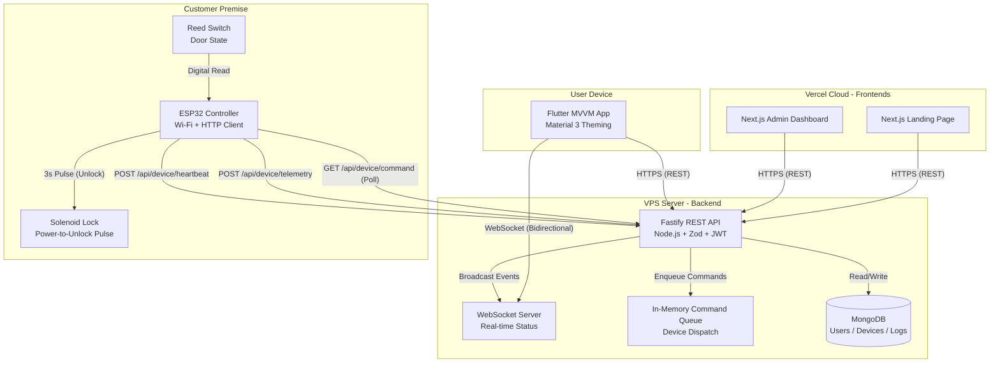

# Secure Box (Solenoid Push-to-Lock)

A full-stack IoT ecosystem for a secure parcel box with push-to-lock mechanism and mobile OTP authentication.

## Architecture



## Core Logic

1. User taps "UNLOCK" in the app
2. Backend enqueues unlock command for the device
3. ESP32 polls command endpoint and receives unlock action
4. ESP32 fires 3-second pulse to solenoid (door pops open)
5. Courier places parcel inside
6. Courier physically pushes door shut (spring-loaded latch)
7. Reed switch detects closure, ESP32 posts telemetry event to `/api/device/telemetry`
8. Backend logs delivery, pushes WebSocket notification to user, and sends delivery email

## Tech Stack

### Backend
- **Runtime**: Node.js + TypeScript
- **Framework**: Fastify
- **Database**: MongoDB (Mongoose)
- **Auth**: JWT (fastify-jwt) + Google OAuth2
- **IoT Communication**: Pure REST/HTTP
- **WebSocket**: @fastify/websocket
- **Validation**: Zod
- **Email**: Resend

### Frontend (Landing & Admin)
- **Framework**: Next.js 16.2+ (App Router)
- **UI**: Tailwind CSS v4 + Lucide Icons
- **Post-processing**: PostCSS
- **State**: React State (Landing) / Redux Toolkit (Admin)
- **HTTP**: Axios

### Mobile
- **Framework**: Flutter (Dart)
- **Architecture**: MVVM
- **HTTP**: Dio
- **Storage**: flutter_secure_storage
- **Biometrics**: local_auth (Fingerprint / Face ID hardware unlock)
- **State**: Provider + ChangeNotifier

## Project Structure

```
Smart_locker/
├── backend/          # Fastify REST API + WebSocket + MQTT
├── landing/          # Next.js Landing Page (Marketing + Authentication)
├── admin/            # Next.js Admin Dashboard (IoT device manager)
├── mobile-app/       # Flutter MVVM Mobile App
├── .gitignore
├── progress.md
├── task.md
├── implementation_plan.md
├── project_blueprint.md
├── Agents.md
└── README.md
```

## Development

### Backend
```bash
cd backend
npm install
npm run dev    # Uses .env.dev
```

### Landing Page
```bash
cd landing
npm install
npm run dev    # Uses .env.dev
```

### Admin Dashboard
```bash
cd admin
npm install
npm run dev    # Uses .env.dev
```

### Mobile
```bash
cd mobile-app
flutter pub get
flutter run
```

## Environment Setup

Each service uses `env-cmd` for environment segregation:
- `.env.dev` - Development configuration
- `.env.prod` - Production configuration

See `.env.example` files in each service directory.
